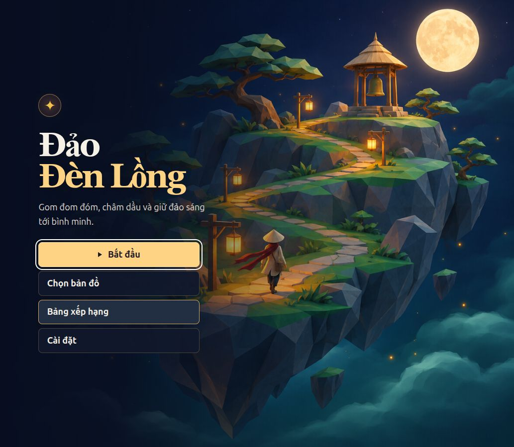

# Đảo Đèn Lồng

Dẫn Mây qua ba hòn đảo nổi, gom đom đóm để thắp và châm dầu cho các Đèn Lồng Lớn. Giữ đủ đèn sáng tới bình minh trong khi tránh Bóng Mực.

[Chạy game](#chạy-game) · [Cách chơi](#cách-chơi) · [Kiểm thử](#kiểm-thử) · [Video demo Phase 4](docs/demo/demo.mp4)



## Chạy game

**Yêu cầu hệ thống.** Python 3.10 trở lên và trình duyệt desktop trên Linux hoặc macOS. Game không cần cài thêm gói Python. Để đo benchmark, cần Google Chrome hoặc Chromium trong phiên đồ họa.

Mở terminal và chạy ba lệnh để chơi từ mã nguồn.

```sh
git clone https://github.com/codenhenhe/K5-L3A-DAY12-NguyenNhutLinh-2A202603492-AI-SDLC-Dao-Den-Long.git
cd K5-L3A-DAY12-NguyenNhutLinh-2A202603492-AI-SDLC-Dao-Den-Long
python3 -m lantern play
```

Nếu trình duyệt chưa tự mở, vào [127.0.0.1:8765](http://127.0.0.1:8765). Nếu cổng mặc định đang được dùng, chạy `python3 -m lantern play --port 8766`.

## Cách chơi

- **Bắt đầu** để chơi chiến dịch qua cả ba Đêm.
- **Chọn bản đồ** để luyện tập một Đêm. Bạn có thể đổi bản đồ khi tạm dừng hoặc sau khi kết thúc Đêm. Điểm luyện tập không vào bảng xếp hạng.

### Mục tiêu mỗi Đêm

Mây thắng khi còn sống lúc đồng hồ về **0:00** và có đủ số đèn đang sáng. Khi tới 0:00, mặt trời mọc sau màn kết quả. Bật **Giảm chuyển động** để xem cảnh bình minh tĩnh.

| Đêm | Bản đồ | Thời lượng | Đèn sáng cần giữ tới bình minh |
| --- | --- | ---: | ---: |
| 1 | Đảo Bến | 4:00 | 3/5 |
| 2 | Đảo Sương | 4:30 | 4/6 |
| 3 | Đảo Chuông | 5:00 | 5/7 |

Đom đóm và Bùa Gió được nhặt tự động. Thắp đèn lần đầu tốn **10 đom đóm**, thắp lại tốn **5**. Đèn sáng hao **1 dầu mỗi giây**. Khi châm, mỗi đom đóm bổ sung **10 dầu**, tới tối đa **100**. Dưới **30 dầu**, đèn nhấp nháy và có thể bị Bóng Mực hút dầu. Sức chứa tăng **2** sau mỗi lần thắp thành công, tối đa **20**.

Ở **Đảo Chuông**, theo mũi tên vàng lên đường dốc tới tầng 1, rồi bước lên bục xanh để nhảy sang tầng tháp. HUD hiển thị tầng và độ cao của Mây.

<details>
<summary>Xem ảnh gameplay Đêm 1</summary>


</details>

### Điều khiển mặc định

| Phím | Thao tác |
| --- | --- |
| `W` `A` `S` `D` | Di chuyển theo hướng camera |
| `←` `→` hoặc kéo chuột | Xoay camera |
| `Space` | Nhảy |
| `Shift` | Lướt |
| `E` | Thắp, thắp lại hoặc châm dầu cho đèn gần nhất còn nhận đom đóm |
| `F` | Tỏa Sáng |
| `Esc` hoặc `P` | Tạm dừng hoặc tiếp tục |

### Cài đặt và hỗ trợ tiếp cận

Trong **Cài đặt**, bạn có thể đổi phím cho 9 hành động, khôi phục phím mặc định, chỉnh âm lượng và độ nhạy, bật chữ lớn (22,5 px) hoặc giảm hiệu ứng rung và chớp. **Bảng màu dễ phân biệt** đổi viền Bóng Mực sang xanh lam và cảnh báo sang trắng kèm biểu tượng.

Game có chỉ báo hướng khi Bóng Mực xuất hiện và cảnh báo bằng chữ khi gió sắp thổi, còn 10 giây hoặc đèn yếu. Cài đặt và phím được lưu theo địa chỉ game trong trình duyệt. Hãy dùng cùng cổng để giữ các tùy chọn đã lưu.

### Điểm và bảng xếp hạng

| Sự kiện | Điểm |
| --- | ---: |
| Nạp một đom đóm | +5 |
| Thắp đèn lần đầu | +100 |
| Thắp lại đèn | +40 |
| Tỏa Sáng trúng một Bóng Mực | +5 |
| Tỏa Sáng trúng một Bóng Mực đang hút dầu | +15 |
| Mỗi đèn đang sáng khi thắng Đêm | +50 và phần nguyên của lượng dầu còn lại |
| Mỗi Ngọn Lửa còn lại khi thắng Đêm | +50 |

Khi thắng cả ba Đêm hoặc khi thua, bạn có thể lưu tổng điểm các Đêm đã thắng. Tên gồm **3–12 ký tự** là chữ ASCII, số hoặc `_`. Xem kết quả trong **Bảng xếp hạng** ở menu chính. Khi thua, bạn cũng có thể chơi lại Đêm đó.

Điểm được lưu trong `~/.local/share/dao-den-long/leaderboard.sqlite3` hoặc dưới `$XDG_DATA_HOME/dao-den-long` nếu đã đặt biến đó. Dùng `LANTERN_DATA_DIR` để chọn thư mục khác.

```sh
python3 -m lantern play --export-leaderboard out.json
```

## Kiểm thử

### Bộ kiểm chứng

```sh
sh scripts/verify-phase-4.sh
```

Bộ kiểm chứng so sánh từng byte của hai lần phát lại cùng đầu vào. Các script dưới đây kiểm tra từng Phase cũ theo tag và luật tương ứng.

```sh
sh scripts/verify-phase-1.sh
sh scripts/verify-phase-2.sh
sh scripts/verify-phase-3.sh
```

### Headless và phát lại

```sh
python3 -m lantern headless --seed 42 --night 2 --ticks 1800 --out /tmp/lantern.jsonl
```

`--night` nhận `1`, `2` hoặc `3`. Dùng `--scenario path.json` để đặt trạng thái ban đầu, `--inputs path.json` để phát lại điều khiển và `--snapshot-every N` để đổi chu kỳ snapshot.

### Benchmark và soak

```sh
python3 -m lantern bench --seed 42 --duration 30 --out bench.json
python3 -m lantern soak --seed 7 --nights 10 --out soak.json
```

**Benchmark** mở Chromium với Canvas 1280×720, tắt vsync và bỏ giới hạn FPS. Giữ cửa sổ ở phía trước khi đo. Có thể đặt `LANTERN_BROWSER` thành đường dẫn tới Chromium. Bản web ghi `peak_mem_mb: null` vì trình duyệt chạy nhiều tiến trình.

**Soak** chạy 10 Đêm headless trong cùng một tiến trình Python và đo RSS trước và sau chuỗi chạy.

Xem [Test Contract v1.3](game.contract.json), [kiểm chứng Phase 4](docs/phase-4.md), [kết quả benchmark](bench.json) và [kết quả soak](soak.json).

## Gói chạy v1.0.0

Tải `dao-den-long-v1.0.0.pyz` từ GitHub Release hoặc tạo gói từ mã nguồn.

```sh
python3 scripts/build_release.py
python3 dist/dao-den-long-v1.0.0.pyz
```

Nếu tải trực tiếp từ Release, chạy `python3 dao-den-long-v1.0.0.pyz` trong thư mục chứa tệp. Gói đi kèm giao diện và tài sản, yêu cầu Python 3.10 trở lên và hỗ trợ các lệnh `play`, `headless`, `bench` và `soak`. Xem [ghi chú phát hành](docs/release-v1.0.0.md).

## Sáng tạo của tôi

Biển mây chuyển động, đom đóm lơ lửng và xung sáng lan trên nền đất. Mây đội nón lá và mang theo một chiếc đèn nhỏ. Trình duyệt dựng hình và phát âm thanh từ trạng thái mô phỏng.

## Tài liệu dự án

- [Hướng dẫn lab](GUIDE.md) · [Checkpoint](CHECKPOINTS.md) · [Quy cách nộp](SUBMISSION.md)
- [Changelog](CHANGELOG.md) · [Retro](docs/retro.md) · [Nguồn tài sản](CREDITS.md) · [Giấy phép](LICENSE)
