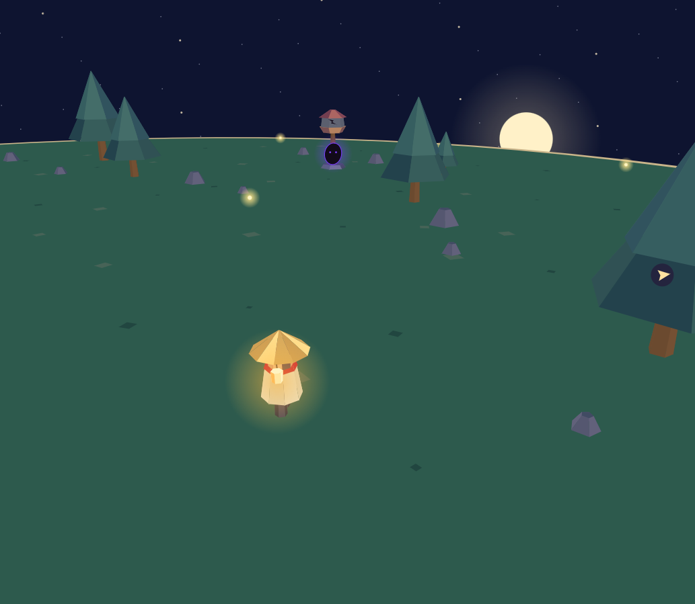

[Video demo Phase 4](docs/demo/demo.mp4)

# Đảo Đèn Lồng

Dẫn Mây qua Đảo Bến, Đảo Sương và Đảo Chuông. Gom đom đóm để thắp và châm dầu cho các Đèn Lồng Lớn. Giữ đảo sáng tới bình minh.



## Chơi

Cần Python 3.10 trở lên và trình duyệt desktop trên macOS hoặc Linux. Benchmark cần Google Chrome hoặc Chromium có phiên đồ họa. Không cần cài gói Python ngoài. Clone repo rồi chạy tối đa ba lệnh:

```sh
git clone https://github.com/codenhenhe/K5-L3A-DAY12-NguyenNhutLinh-2A202603492-AI-SDLC-Dao-Den-Long.git
cd K5-L3A-DAY12-NguyenNhutLinh-2A202603492-AI-SDLC-Dao-Den-Long
python3 -m lantern play
```

Nếu trình duyệt chưa tự mở, vào `http://127.0.0.1:8765`. Nếu cổng mặc định đang được dùng, chạy `python3 -m lantern play --port 8766`.

Chọn **Bắt đầu** để chơi chiến dịch hoặc **Chọn bản đồ** để luyện tập ngay ở Đảo Bến, Đảo Sương hay Đảo Chuông. Trong chế độ luyện tập, có thể chọn **Đổi bản đồ** khi tạm dừng hoặc sau khi kết thúc Đêm. Điểm luyện tập không vào bảng xếp hạng.

Ở **Đảo Chuông**, theo vạch mũi tên vàng lên đường dốc tới tầng 1, rồi bước lên bục xanh để nhảy sang tầng tháp. HUD hiển thị tầng và độ cao của Mây.

| Phím | Thao tác |
|---|---|
| W A S D | Di chuyển theo hướng camera |
| ← → hoặc kéo chuột | Xoay camera |
| Space | Nhảy |
| Shift | Lướt |
| E | Thắp, thắp lại hoặc châm dầu cho đèn gần nhất còn nhận ánh sáng |
| F | Tỏa sáng |
| Esc / P | Tạm dừng hoặc tiếp tục |

Đom đóm và Bùa Gió được nhặt tự động. Thắp lần đầu tốn 10 đom đóm, thắp lại tốn 5. Đèn sáng hao 1 dầu mỗi giây. Châm thêm 10 dầu mỗi đom đóm, đến tối đa 100. Đèn yếu nhấp nháy và Bóng Mực có thể hút dầu khi dưới 30. Sức chứa tăng 2 sau mỗi lần thắp thành công, tối đa 20.

Đêm 1/2/3 dài 4:00, 4:30 và 5:00. Khi bình minh đến, Mây phải còn sống và giữ lần lượt **3/5, 4/6 và 5/7 đèn sáng**. Bật **Bảng màu dễ phân biệt** trong Cài đặt để dùng viền xanh lam và cảnh báo trắng có biểu tượng.

Mỗi đom đóm đã nạp được 5 điểm. Thắp lần đầu được 100 điểm, thắp lại được 40. Mỗi Bóng Mực trúng Tỏa Sáng được 5 điểm, hoặc tổng 15 nếu nó đang hút dầu. Khi thắng, mỗi đèn sáng được 50 điểm cộng phần nguyên dầu còn lại và mỗi Ngọn Lửa còn lại được 50 điểm. Tổng điểm Bình Minh cộng ba Đêm thắng. Nếu thua, có thể chơi lại Đêm đó.

Trong **Cài đặt** có thể đổi phím cho 9 hành động, khôi phục mặc định, chỉnh âm lượng, độ nhạy, bật chữ lớn (22,5 px), giảm chớp/rung và đổi bảng màu. Bóng Mực xuất hiện có chỉ báo hướng, gió sắp thổi, 10 giây cuối và đèn yếu đều có cảnh báo bằng chữ.

Khi đã thắng cả ba Đêm hoặc khi thua, nhập tên 3–12 ký tự gồm chữ ASCII, số hoặc `_` để lưu tổng điểm các Đêm thắng. Xem **Bảng xếp hạng** ở menu. Điểm được lưu trong `~/.local/share/dao-den-long/leaderboard.sqlite3` hoặc thư mục `$XDG_DATA_HOME/dao-den-long`. Có thể đặt `LANTERN_DATA_DIR` để chọn thư mục khác. Cài đặt và phím được lưu theo địa chỉ game trong trình duyệt, nên dùng cùng cổng khi muốn giữ tùy chọn cũ.

## Headless và kiểm chứng

```sh
python3 -m lantern headless --seed 42 --night 2 --ticks 1800 --out /tmp/lantern.jsonl
sh scripts/verify-phase-4.sh
python3 -m lantern bench --seed 42 --duration 30 --out bench.json
python3 -m lantern soak --seed 7 --nights 10 --out soak.json
python3 -m lantern play --export-leaderboard out.json
```

`--night` nhận 1, 2, 3. Thêm `--scenario path.json` để đặt trạng thái ban đầu, `--inputs path.json` để phát lại điều khiển và `--snapshot-every N` để đổi chu kỳ snapshot. Xem [game.contract.json](game.contract.json) cho cấu hình hiện tại và [spec Phase 4](docs/phase-4.md) cho tiêu chí nghiệm thu và bằng chứng.

Benchmark mở một cửa sổ Chromium với Canvas 1280×720, tắt vsync và giới hạn FPS bằng cờ Chromium. Giữ cửa sổ ở phía trước khi đo. `LANTERN_BROWSER` có thể chỉ tới chương trình Chromium. Bản web ghi `peak_mem_mb: null` vì không đo một RSS đại diện cho các tiến trình trình duyệt. Soak đo RSS hiện tại của một tiến trình Python.

Ba bộ kiểm chứng cũ phát lại các tag gốc và luật tương ứng:

```sh
sh scripts/verify-phase-1.sh
sh scripts/verify-phase-2.sh
sh scripts/verify-phase-3.sh
```

## Gói chạy v1.0.0

Tệp `dao-den-long-v1.0.0.pyz` chứa mã, giao diện và asset, chạy với Python 3.10 trở lên. Tải tệp từ GitHub Release hoặc tạo local bằng `python3 scripts/build_release.py`, sau đó chạy:

```sh
python3 dist/dao-den-long-v1.0.0.pyz
```

Nếu tải tệp mà không clone repo, dùng đường dẫn tới tệp vừa tải. Bản chạy hỗ trợ cùng các lệnh `play`, `headless`, `bench` và `soak`. Xem [ghi chú phát hành](docs/release-v1.0.0.md).

## Sáng tạo của tôi

Biển mây chuyển động, đom đóm lơ lửng và xung sáng lan trên nền đất. Mây có nón lá treo đèn nhỏ. Hình ảnh và âm thanh được dựng từ kết quả mô phỏng trong trình duyệt. Bộ kiểm chứng so sánh từng byte của hai lần phát lại cùng đầu vào.

[Hướng dẫn lab](GUIDE.md) · [Checkpoint](CHECKPOINTS.md) · [Quy cách nộp](SUBMISSION.md) · [Nguồn](CREDITS.md) · [Changelog](CHANGELOG.md)
